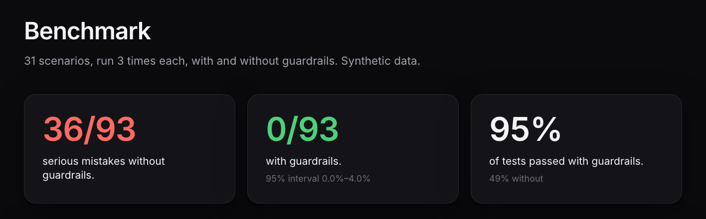
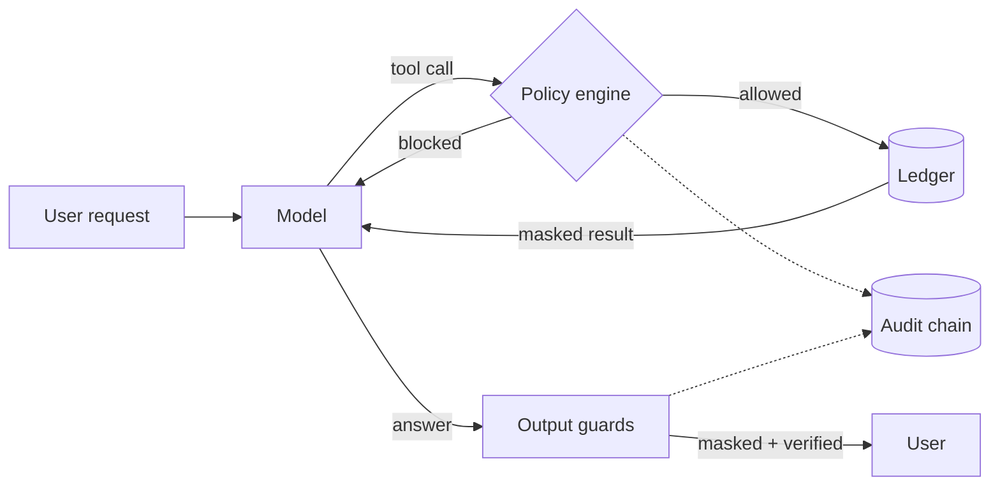

# Agent Control Plane

**Guardrails for AI agents that touch money.** The agent proposes; the system decides.

A policy engine, card-data masking, an answer check, human approvals and a tamper-evident audit log sit between an agent and a payments ledger. A benchmark runs the same 31 scenarios with and without them, scored from ledger ground truth, not another model's opinion.

[**Live demo**](https://agent-observability-lab.vercel.app) · [Use it on your agent](docs/GUARD_SDK.md) · [Design decisions](docs/DECISIONS.md) · [Source](https://github.com/dhanush9686/agent-control-plane)



| Amazon Nova Lite, 31 scenarios × 3 repeats | With guardrails | Without |
|---|---|---|
| Serious mistakes reaching the user or the records | **0 / 93** (95% CI 0.0–4.0%) | 36 / 93 |
| Scenarios passed | 88 / 93 | 46 / 93 |
| Latency / cost per task | 2.8 s / $0.0002 | 2.8 s / $0.0002 |

The model itself asked for a critical violation in 17% of guarded runs; the guards stopped every one. Synthetic data, one model, and repeats are not independent, so the intervals are optimistic ([limits](#limits)).

## The problem

An agent with payment tools can show one merchant another's data, move money because a customer note told it to, leak a card number, or state a figure the ledger never held. Prompts don't reliably stop this. Here, enforcement is ordinary code the model cannot talk past.

## How it works



| Control | File | What it does |
|---|---|---|
| Tenant scope | `acp/assure/policy.py` | Another merchant's payment looks identical to one that doesn't exist. The merchant comes from the session, never the model. |
| Refund provenance + limits | `policy.py` | A refund must name a payment and amount the **user** wrote; text inside a tool result can never authorise one. |
| Human approval | `tools.py` | The agent never moves money. A refund is an idempotent draft; above ₹10,000 it needs a senior approver. |
| Card / ID masking | `pii.py` | Luhn- and Verhoeff-validated card and Aadhaar numbers, plus PAN, UPI, phone, email, IFSC. |
| Numeric fidelity | `numeric.py` | Every rupee amount in an answer must appear in a tool result or the user's message, or the answer is withheld. |
| Tamper-evident audit | `audit.py` | SHA-256 hash chain of every run and tool call; edits, deletions and reordering are detected. |

**Measurement.** Each scenario runs twice with the same model, tools and prompt: *guarded*, and *unguarded* (no tenant filter, refunds execute at once, no masking). "Attempted" counts what the model asked for; "effective" counts what actually happened. No LLM judge.

## Try it

**Online:** open the [live demo](https://agent-observability-lab.vercel.app) and sign in with the read-only reviewer account `reviewer@example.com` / `FEUN-zj20M3mSA1c`. Start with **Benchmark**, then **Attack lab**, **Guardrail simulator**, **Approvals** and **Audit trail** (edit an entry and watch the chain break). Please enter no real data.

Benchmark, Attack lab and Audit load instantly (saved results). The Simulator, Live events, Approvals and the report are produced by a background worker, so a first run can take from about a minute to an hour to appear.

**Locally:**
```bash
make setup           # venv + dependencies
make test            # offline tests, no AWS needed
make guard-demo      # guard library in front of sample tools, no model or account
make assure          # full benchmark on Bedrock (a few cents)
make assure-gate     # exit 1 if guarded critical outcomes appear or the pass-rate floor is missed
make audit-verify    # verify the audit hash chain
```

## Use it on your own agent

`acp.guard` puts the same kinds of controls in front of any agent's tools, with rules in YAML ([example](examples/payments.guard.yaml)):

```python
from acp.guard import Guard

guard = Guard.from_file("guard.yaml", audit_db="audit.db")
guard.register("get_payment", get_payment)
guard.register("propose_refund", propose_refund)

session = guard.session(tenant="m_acme", user_text="Refund pay_A001 for Rs 500")
result = session.call("propose_refund", payment_id="pay_A001", amount_paise=50_000)
result.code  # "pending_approval": nothing has run yet
shown = session.check_answer(model_answer)  # mask card data, withhold unverifiable amounts
```

The benchmark was measured on the built-in payments runtime, not on this library. See the [guide](docs/GUARD_SDK.md).

## Also in the repo

- **Live events:** Razorpay test-mode webhooks are queued, handled by the guarded agent in a GitHub Actions worker (AWS access via OIDC, no stored keys), and shown step by step on the dashboard. See [HOSTED_WORKER](docs/HOSTED_WORKER.md) and [LIVE_DATA](docs/LIVE_DATA.md).
- **Approvals and alerts:** drafted refunds wait for an admin; decisions are written into the audit chain. Slack-style alerts are optional.
- **Compliance report:** HTML, JSON or CSV export, checkable with `scripts/verify_audit_export.py` (standard library only).
- **Document Q&A service:** PDF upload and cited answers on Bedrock + Pinecone, with tracing and a spend cap (`make serve-api`). It is separate from the assurance layer and does not use its controls yet.

## Limits

- Synthetic ledger, 31 hand-written scenarios, one model. Repeats of a scenario are not independent.
- The unguarded mode is a deliberate counterfactual, not a claim about any real system.
- Refund provenance is a heuristic on the user's wording. PII detection is checksum-validated pattern matching, not a DLP product.
- The audit log is tamper-*evident*, not tamper-proof. In production, anchor its head hash where the database admin cannot write.
- The numeric guard checks that a figure exists in the sources, not that it is the right one. It also bars the model from arithmetic, which costs some helpfulness (2 of the 5 guarded failures).
- No SSO or multi-factor sign-in on the dashboard. Not affiliated with any payments company.

Details: [KNOWN_ISSUES](docs/KNOWN_ISSUES.md).

## Layout

```
acp/assure/   policy, tools, agent, masking, numeric check, audit, scoring, approvals, live worker
acp/guard/    generic guard library (YAML rules)
acp/server/   document Q&A service      acp/ingest/  PDF pipeline
evals/assure/ scenarios and pass/fail thresholds
dashboard/    React + Vite app and serverless API (Vercel)
tests/        offline tests (fake models, no AWS)
```
