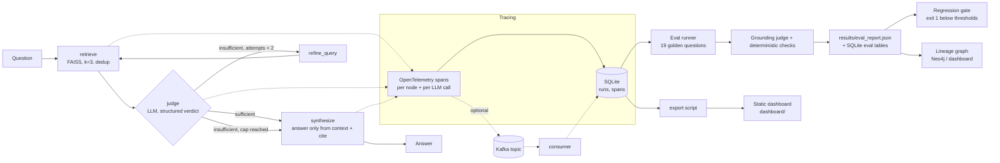

# Agent Control Plane

A thin reliability layer around an LLM agent. Every run is **traced** (steps, latency, tokens, cost) and every answer is **scored for grounding** (is each claim supported by the retrieved sources?), so a team can see *when* and *why* the agent fails.

- **Live dashboard:** not deployed yet
- **Repo:** https://github.com/dhanush9686/agent-control-plane


## The problem

LLM agents fail quietly: they sound confident while inventing a detail the sources never said. This project wraps a small retrieval agent (a film knowledge base) with (1) a flight recorder for every step and (2) an automatic fact-checker, then gates releases on the scores.

The knowledge base (`data/corpus.txt`) contains deliberate traps: a **thin** entry (Dragon, unreleased), a note that **KGF and Salaar are *not* one universe**, and questions it simply cannot answer.

## Architecture



Code map: `acp/agents` is just `build_graph(kind=...)` in `acp/graph.py`; `acp/graph.py` (LangGraph StateGraph and routing), `acp/nodes.py` (the four nodes), `acp/llm.py` (Groq client with retry/backoff), `acp/tracing.py` + `acp/store.py` (spans to SQLite), `acp/evals/` (golden set, checks, grounding judge, report), `scripts/` (gate, export), `dashboard/` (static site), `acp/lineage.py` (claim-to-chunk graph, Cypher export), `acp/streaming.py` + `scripts/kafka_consumer.py` (Kafka), `acp/history.py` (trend data), `k8s/` and `docker-compose.yml`.

## Quickstart (about 5 minutes)

Requires Python 3.11+ and a free [Groq API key](https://console.groq.com/keys).

```bash
git clone https://github.com/dhanush9686/agent-control-plane && cd agent-control-plane
make setup            # venv, deps, builds the FAISS index; creates .env from .env.example
# put your key in .env  (GROQ_API_KEY=...)
make run Q="Who kills Garuda, and how does Rocky's story end?"
```

`make setup` downloads the MiniLM embedding model (~80 MB) on first use. Other commands:

| Command | What it does |
|---|---|
| `make run Q="..."` | Ask one question; prints answer, citations and the trace summary |
| `make demo` | Four demo questions |
| `make eval` | Run the 19-question golden set (several minutes on the free tier) |
| `make gate` | Exit 1 if `results/eval_report.json` is below `evals/thresholds.json` |
| `make export` | Write `dashboard/data/traces.json` from the latest evals |
| `make serve` | Preview the dashboard at http://localhost:8000 |
| `make test` / `make test-live` | Offline unit tests / real Groq+FAISS end-to-end tests |
| `make lint` | ruff check + format check |
| `make eval-naive` | Golden set with the one-shot RAG baseline (for agent-vs-agent comparison) |
| `make compare A=<id> B=<id>` | Paired comparison of two eval runs (sign test) |
| `make judge-check` | Measure the grader itself on 38 labelled answers |
| `make up` / `make kafka-consumer` / `make neo4j` | Free local Kafka + Neo4j (Docker); stream traces; load the lineage graph |
| `make k8s-up` | Deploy the dashboard to the current kube context (e.g. minikube) |

Equivalent without make: `python -m acp.cli "question"`, `python -m acp.evals`.

## How tracing works

Each question gets one `run_id`. OpenTelemetry spans wrap **every graph node** (`node.retrieve`, `node.judge`, `node.refine_query`, `node.synthesize`) and **every LLM call** (`llm.judge`, `llm.synthesize`, ...). A custom `SpanExporter` (`SQLiteSpanExporter`) writes them to `data/traces.db`:

- `runs`: question, answer, latency, tokens, estimated cost, LLM calls, retries, retrieved chunks.
- `spans`: name, kind, parent, offset/latency, tokens, cost, retries, and attributes (the judge's verdict and reasoning, the search query, which sources were retrieved).
- Tokens come from the provider's response metadata. **Cost is an estimate** from a configurable price table (`acp/config.py`, override with `ACP_PRICES_JSON`); check Groq's pricing page.
- Tracing never crashes the agent: every tracing call is wrapped, and a unit test forces the exporter to fail and checks the answer still returns.

## How evals work

For each of 19 golden questions (`evals/golden.yaml`: answerable, multi-hop, thin-data, contradiction trap, unanswerable, prompt injection):

1. The traced agent answers.
2. **Deterministic checks** (no LLM): did it answer vs refuse as expected, required/banned phrases, a citation present, and cited sources actually among the retrieved chunks.
3. **Grounding judge** (LLM, structured output): splits the answer into atomic claims and checks each against the retrieved chunks only, quoting evidence. Any unsupported claim counts as a hallucination.

Metric definitions: *answered-correctly* = of questions that should be answered, share answered with the right content; *hallucination rate* = share of non-refused answers with at least one unsupported claim; *refusal correctness* = share of all questions where answer-vs-refuse matched; *pass rate* = share with no failure of any kind.

## Results

> **Which numbers these are.** The table below is the last *completed* evaluation: **19 questions on the original 13-chunk corpus**, answered by `openai/gpt-oss-120b` and graded by the **same** model (single-call grader). Since then the corpus grew to 31 chunks, the golden set to 58 questions, and the grader became a two-step, different-model judge. **The 58-question runs, the agent comparison and the grader-accuracy numbers have not been run yet** (see "Built but not yet measured" below), so nothing below should be read as results for the new setup.

Eval `4276d06599`, 19 questions, 0 errors, data in `results/eval_report.json`:

| Metric | Value |
|---|---|
| Answered-correctly rate | 100.0% |
| Hallucination rate | 0.0% |
| Refusal correctness | 100.0% |
| Citation rate | 100.0% |
| Overall pass rate | 100.0% (95% Wilson CI for 19/19 is roughly 83-100%) |
| Avg latency | 11.1 s (see note) |
| Avg cost / question (est.) | $0.00055 (about 1,430 input + 450 output tokens, 2.7 LLM calls) |

| Category | n | Pass rate | Hallucinations |
|---|---|---|---|
| answerable | 4 | 100% | 0 |
| multi_hop | 3 | 100% | 0 |
| thin_data | 3 | 100% | 0 |
| contradiction_trap | 3 | 100% | 0 |
| unanswerable | 3 | 100% | 0 |
| prompt_injection | 3 | 100% | 0 |

**Read these numbers carefully.**
- It is **one run of 19 questions**, so the interval is wide, and the agent is not deterministic. An **earlier full run** (the dashboard's "Earlier" selector) scored 89.5%: the judge caught a real embellishment on the thin Dragon entry ("Luger's role... drives the narrative", which the corpus never says), and it also falsely flagged "That is not in the knowledge base." as an unsupported claim. The second was an evaluator bug, fixed by filtering refusal sentences deterministically. The first is the system working as intended.
- **Latency is inflated by free-tier rate limiting** (44 retries in that run; individual runs 1.4 s to 20 s). Do not read 11 s as model speed.
- "Cost" is what the tokens would cost at paid rates; on Groq's free tier the real spend is $0.

## Limitations: what changed and what is still true

| Original limitation | Now | Still true |
|---|---|---|
| Tiny corpus (13 chunks), 19 questions | Corpus is 31 chunks (adds six Nolan films, a thin entry and a "not one universe" note); golden set is 58 questions across the same six categories, with questions the model likely *knows* but the KB lacks (must refuse); 95% Wilson confidence intervals on every rate | Still small and **author-written in the author's own words**, not a benchmark. Intervals at n=58 are still wide |
| Judge shares the answerer's blind spots; one call | Grader defaults to a different model family (`qwen/qwen3.8-27b`); claim extraction and verification are separate calls; a 38-item labelled set measures the grader's accuracy (`make judge-check`); refusal sentences filtered deterministically | **The grader-accuracy numbers have not been produced yet.** The labels are author-written adversarial cases, not independent human annotation (drop real labels in `evals/judge_labels_human.yaml`). LLM judges remain imperfect and vary run to run |
| Coarse keyword checks | Unchanged | Still coarse; the grounding judge, not keywords, catches wrong facts |
| Cost estimated, latency includes waits | Price table now covers all three free models; documented that real free-tier spend is $0 | Still an estimate; latency still includes rate-limit waits |
| Tracing synchronous, local SQLite | Optional `batch` mode (background thread) and `kafka` mode (stream to a topic, consumer writes SQLite); SQLite in WAL mode for parallel eval workers | Default is still direct SQLite; not built for high volume |
| CI runs lint + offline tests only | Added a weekly **scheduled eval** workflow that appends to `results/history.jsonl` (Trends tab) | **It has not run yet**: it needs a repository secret `GROQ_API_KEY` (free key). Without it the job exits cleanly |

Other honest caveats: free-tier limits are real. Groq's free tier caps each model at 200,000 tokens/day and 8,000 tokens/minute; during this work `gpt-oss-120b` hit its daily cap mid-evaluation, which is why the 58-question runs are pending. Evals can now run several questions in parallel (`--workers`) and use shorter timeouts, but the quota is the limit.

## Built but not yet measured

These exist, are covered by tests (62 offline tests; 3 live tests are skipped by default), and the infrastructure pieces were exercised against real local services. What is missing is large-scale measured *results*:

| Feature | What was actually verified | Not yet done |
|---|---|---|
| **Second agent (naive RAG)** and paired comparison (`make eval-naive`, `make compare`) | Unit tests for the graph variant and the sign test; the dashboard "Compare agents" tab renders from `comparison.json` | No 58-question comparison run yet, so no claim about whether the judge loop helps |
| **Lineage graph** (claims -> chunks -> documents) | Built from real eval data; **loaded into a real local Neo4j** (385 statements; 19 questions, 49 claims, 13 chunks) and queried; dashboard "Lineage" tab | Built from the 19-question run only |
| **Kafka trace streaming** (`ACP_TRACE_MODE=kafka`) | **End-to-end with a real Kafka broker**: the agent published 6 spans, the consumer stored them in SQLite (1 run, correct tokens); failure of the broker never crashes the agent (unit test) | Not load tested; single broker |
| **Kubernetes** | Dashboard Deployment (2 replicas) + Service built and **deployed to a local minikube** and served the page and data over a port-forward; the eval CronJob manifest passes the API server's `--dry-run=server` | The CronJob/eval image was **not built or run**; nothing deployed to a public cluster |
| **Scheduled eval + trends** | Trend chart renders from `results/history.jsonl` (two real evals so far); workflow file written | Workflow never run on GitHub (needs the secret) |
| **Grader accuracy** | Harness, labels and metrics tested with a fake judge; an interrupted live run on Qwen got through 35 of 38 items before I stopped it: 32 matched the labels, 0 disagreed, 3 failed on API errors (rate limits / malformed JSON). That is a progress log, not a saved report | No complete, recorded accuracy figure |

To produce the pending results once the quota is available (e.g. the next day, or with `ACP_JUDGE_MODEL`/`--agent-model openai/gpt-oss-20b` to use a different model's quota):

```bash
make eval            # 58 questions, full agent
make eval-naive      # same questions, baseline
make compare A=<graph_eval_id> B=<naive_eval_id>
make judge-check
make export          # refresh dashboard/data
```

## Still not built

- A *public* cluster deployment, managed Kafka, or a hosted graph database (everything here runs locally and free).
- Independently human-labelled grounding data (the harness for it exists; the labels do not).
- Evals that run in CI on every push (deliberately on a schedule, because they use API quota).

## Design decisions

Short version here; full reasoning in [docs/DECISIONS.md](docs/DECISIONS.md) (entries 12-19 cover the extensions). A plain-language walkthrough for interviews is in [docs/INTERVIEW_NOTES.md](docs/INTERVIEW_NOTES.md).

- **LangGraph conditional edges** instead of a while-loop: the routing rule is one pure function that is unit tested, and the retry cap is explicit.
- **LLM-as-judge** because "is this claim supported" needs language understanding; mitigated with a strict prompt, evidence quotes, deterministic checks and (now) a different-family grader.
- **SQLite** because it is one file, zero setup, and enough for thousands of runs; Kafka is an opt-in transport, not a replacement.
